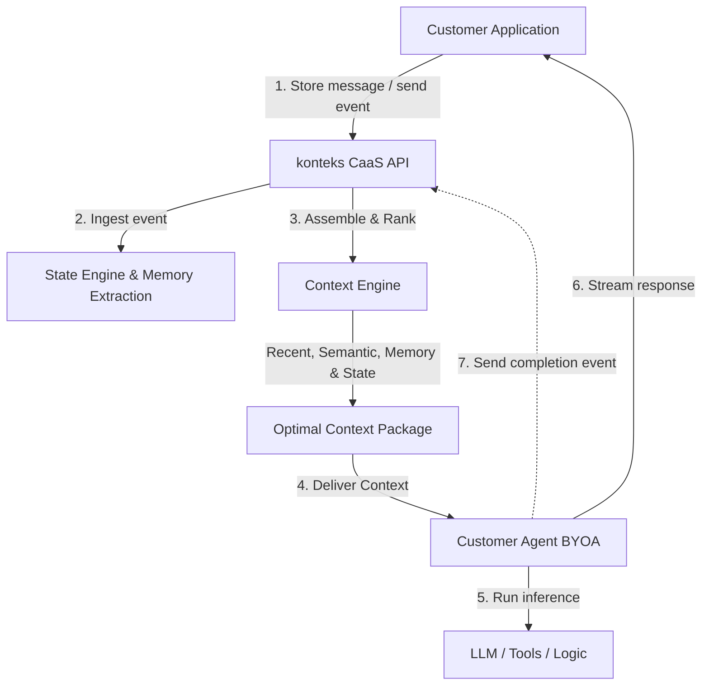

# konteks

> **You build the agent. We manage its context.**

`konteks` is a model-agnostic, agent-agnostic **Context Infrastructure / Context-as-a-Service (CaaS)** layer that manages stateful AI conversations: rooms, messages, context retrieval, memory, state compaction, and context delivery.

---

## 1. Vision & Core Promise

Developers should not have to rebuild complex state and conversation history management every time they build a new AI agent. `konteks` acts as the state/context layer underneath your agent, ensuring your agent receives **exactly the context it needs for every turn—no more, no less.**

```
   ┌──────────────────────────────────────────────┐
   │                 APPLICATION                  │
   │  Chat UI / Tool Execution / Business Logic   │
   └──────────────────────┬───────────────────────┘
                          │
                          ▼
   ┌──────────────────────────────────────────────┐
   │                   KONTEKS                    │
   │  Context Retrieval / Memory / Compaction     │
   └──────────────────────┬───────────────────────┘
                          │
                          ▼
   ┌──────────────────────────────────────────────┐
   │                   AI AGENT                   │
   │  LLM Reasoning & Tool Selection (BYOA)       │
   └──────────────────────────────────────────────┘
```

### The Division of Concerns

*   **You (the Customer) Own:** The LLM provider, agent reasoning loop, system prompts, tool definitions, tool execution runtime, and business logic.
*   **`konteks` Owns:** Conversation rooms, message persistence, state extraction, semantic retrieval, context selection, summarization, entity/reference resolution, and context lifecycle management.

---

## 2. Core Concepts

### Room-First Abstraction
A `Room` is the fundamental primitive representing one persistent conversation. It consolidates:
*   **Messages:** Raw chat history.
*   **State:** The current conversation topic, user preferences, and structured variables (e.g., `budget: $150`).
*   **Summary:** Continuously updated, lightweight conversation summaries.
*   **Memories:** Long-term user preferences and temporal facts.
*   **Events:** Hooked lifecycles from tools and agents.

### Context vs. Memory
`konteks` maintains a clear boundary between:
*   **Memory:** Longer-lived facts (e.g., *"User prefers hotels with a pool"*).
*   **Active Context:** What matters *right now* for the current turn (e.g., *"User is booking Hotel B on Friday"*). `konteks` continuously compiles memory, recent messages, and tool outputs into an optimal **Context Package**.

### Bring Your Own Agent (BYOA) & Bring Your Own Data (BYOD)
*   **BYOA:** `konteks` exposes a clean JSON context package. It does not act as an LLM proxy or enforce an agent framework. It works with LangGraph, LlamaIndex, or custom scripts in TypeScript, Python, or Go.
*   **BYOD:** Integrates with your existing databases (Postgres, MongoDB, Firestore, CRM) without requiring you to migrate your primary chat history or business data.

---

## 3. High-Level Architecture



---

## 4. Quick Start (5-Minute Integration)

Integration requires only a few REST API calls.

### Step 1: Create a Room
Initialize a stateful room for your conversation:

```bash
curl -X POST https://api.konteks.dev/v1/rooms \
  -H "Authorization: Bearer $KONTEKS_API_KEY"
```

### Step 2: Push User Message
Store incoming messages to update conversation state:

```bash
curl -X POST https://api.konteks.dev/v1/rooms/room_123/messages \
  -H "Authorization: Bearer $KONTEKS_API_KEY" \
  -H "Content-Type: application/json" \
  -d '{
    "role": "user",
    "content": "Find me a hotel in Bali with a pool."
  }'
```

### Step 3: Get the Optimal Context
Retrieve the curated context package to send to your LLM:

```bash
curl -X POST https://api.konteks.dev/v1/rooms/room_123/context \
  -H "Authorization: Bearer $KONTEKS_API_KEY"
```

**Example Context Package Response:**
```json
{
  "room_id": "room_123",
  "context": {
    "summary": "User is seeking hotel options in Bali with a pool.",
    "active_topic": "hotel search",
    "state": {
      "location": "Bali",
      "amenities": ["pool"]
    },
    "relevant_messages": [
      { "role": "user", "content": "Find me a hotel in Bali with a pool." }
    ],
    "memories": [
      { "content": "User prefers budget <$150/night." }
    ]
  }
}
```

### Step 4: Run Your Agent
Pass the context package directly into your LLM prompt:

```python
context = caas.get_context(room_id="room_123")
prompt = f"Context: {context['summary']}\nState: {context['state']}\nHistory: {context['relevant_messages']}\nUser: ..."

response = openai.chat.completions.create(
    model="gpt-4",
    messages=[{"role": "user", "content": prompt}]
)
```

---

## 5. Technology Stack

*   **Backend:** Go (Chi router, `pgx` driver) for high concurrency, low memory overhead, and efficient streaming/SSE.
*   **Primary Database:** PostgreSQL with `pgvector` for scalable relational storage and semantic embeddings.
*   **Caching & Coordination:** Redis for rate limiting, distributed locks, pub/sub, and stream coordination.
*   **Memory Engines:** Supports integrations with native engines, Honcho, Redis Agent Memory Server, Zep, and Mem0.

---

## 6. Project Roadmap

### Phase 0 — Prototype (Current)
- [x] Lightweight Go API + Postgres (`pgvector`)
- [x] Basic context retrieval (Recent + Semantic)
- [x] Initial memory provider integration

### Phase 1 — MVP
- [ ] Stateful Room & Message API
- [ ] Real-time SSE/Webhooks for conversation events
- [ ] Managed background summarization & compaction
- [ ] Usage metering & developer dashboard

### Phase 2 — Context Engine Refinement
- [ ] Automatic reference resolution (*"it"*, *"which one"*)
- [ ] Context policies (token budget constraints, freshness)
- [ ] Structured state tracking and JSON extraction

### Phase 3 — Platform Scale
- [ ] Multi-provider memory router (Honcho, Redis AMS, Zep)
- [ ] Context quality scoring & observability analytics
- [ ] Multi-language SDK ecosystem (TypeScript, Python, Go)
