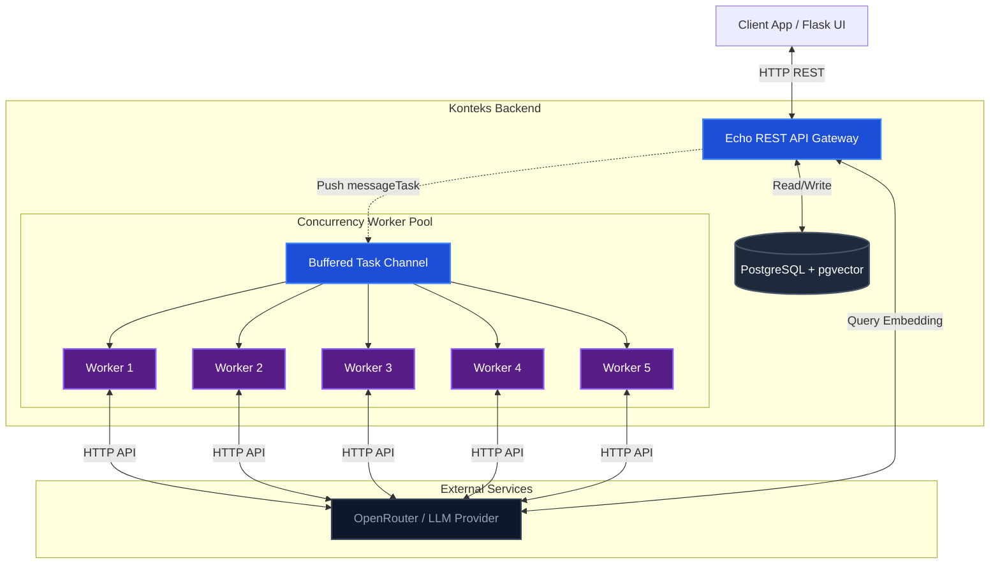
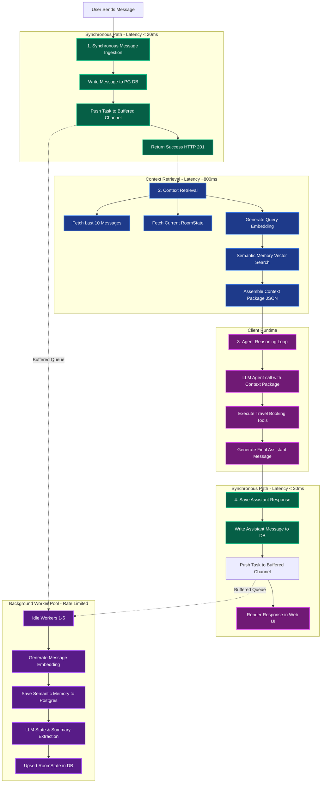
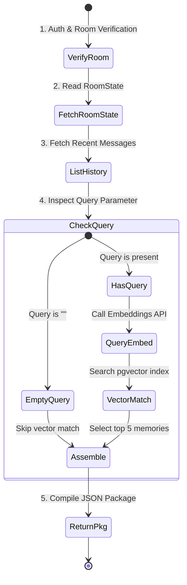

# Konteks Backend Architecture

This document details the architecture, end-to-end data flow, and context generation process of the `konteks` Context-as-a-Service (CaaS) layer.

---

## 1. High-Level System Architecture

Konteks acts as the stateful memory and context layer underneath your AI Agent. The diagram below illustrates the components of the Konteks backend and how they interact:



---

## 2. End-to-End Chat Turn Flowchart

The flowchart below demonstrates the sequence of events during a single user-agent turn, separating the **synchronous critical path** (for low latency) from the **asynchronous state extraction path** (managed by the worker pool):



---

## 3. How the Context Package is Generated

When the agent client calls the `POST /v1/rooms/:room_id/context` API endpoint, the Konteks backend compiles the minimum sufficient context required for the agent to complete the current conversation turn. 

Here is the detailed step-by-step logic executed inside `contextUsecase.GetContextPackage`:



### Detailed Breakdown of Steps:

#### Step 1: Authorization & Verification
The endpoint verifies the API Token via standard Authorization headers and checks that the requested `room_id` belongs to the authenticated client tenant (`tenant_id`).

#### Step 2: Fetch Room State
The system reads the `room_state` table for the room. It retrieves:
*   **Active Topic**: E.g. `"hotel comparison"`.
*   **Summary**: A continuously updated running summary of the conversation.
*   **State Variables**: A flat JSONB object containing parameters gathered so far (e.g. `{"destination": "Tokyo", "budget": 150}`).

#### Step 3: Fetch Message History
The server queries the `messages` table for the last 10 messages associated with this room. This provides the LLM with the most recent local conversation context.

#### Step 4: Semantic Memory Search (Optional)
If a `query` string (typically the user's message) is passed to the context endpoint:
1.  **Generate Query Embedding**: Konteks calls the embedding model (`qwen/qwen3-embedding-8b`) via OpenRouter to generate the query's vector representation.
2.  **pgvector Matching**: It runs a cosine-similarity distance search in Postgres against the `memories` table:
    ```sql
    SELECT content FROM memories 
    WHERE room_id = $1 OR external_user_id = $2 
    ORDER BY embedding <=> $3 LIMIT 5;
    ```
    This pulls relevant historical user preferences (e.g. *"User prefers hotels with a pool"* or *"Paris budget was $100"*).

#### Step 5: Assembly
The backend packages the `Summary`, `ActiveTopic`, `StateVariables`, `RelevantMessages`, and `Memories` into the standard `ContextPackage` response format and returns it to the client.

---

## 4. Background Asynchronous Worker Loop

The background Worker Pool controls resource usage and prevents rate-limit issues.

### Concurrency Regulation
*   **Task Queue**: The `taskQueue` is a buffered channel in memory with a size limit of 5,000. It absorbs incoming write bursts.
*   **Fixed Workers**: A pool of exactly 5 workers are spawned on startup. Each worker runs in an infinite loop pulling tasks from the channel:
    ```go
    func (u *messageUsecase) worker() {
        for task := range u.taskQueue {
            u.processBackgroundUpdate(task)
        }
    }
    ```
*   **OpenRouter Concurrency Capping**: Because there are only 5 workers, the system makes a maximum of 5 concurrent HTTP requests to OpenRouter for embedding generation and state extraction, keeping our API credentials safe from rate-limit bans (TPM/RPM limits).
