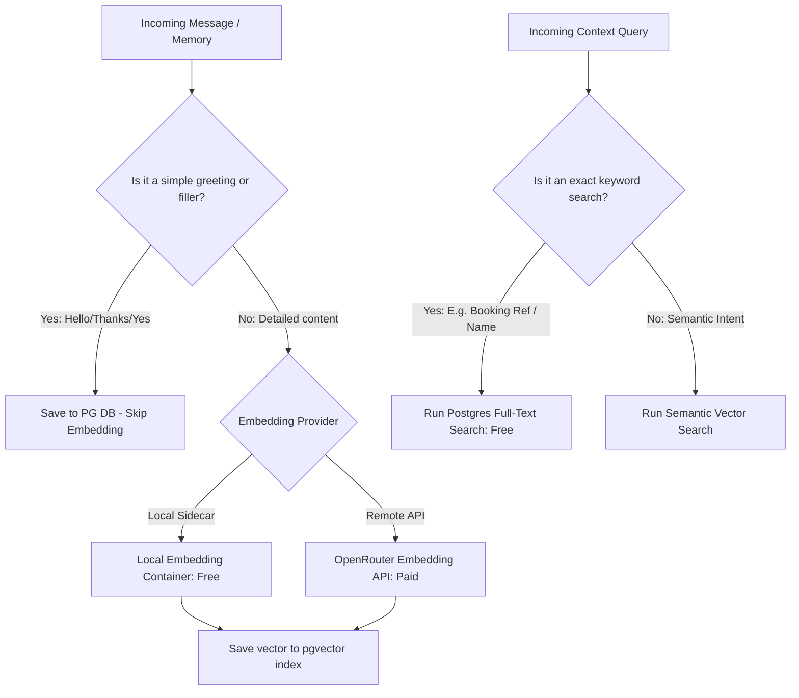

# Hybrid Embedding & Search Cost Optimization

This document outlines strategies and architectural modifications to reduce vector embedding costs and latency in the `konteks` backend.

---

## 1. The Cost & Latency Problem

In the baseline architecture, every single chat turn triggers:
1.  **Message Embedding (POST /messages)**: Calls the OpenRouter embedding API to vector-index the new message.
2.  **Query Embedding (POST /context)**: Calls the OpenRouter embedding API again to vectorize the incoming search query.

At scale, this yields:
*   **High API Cost**: Multiplied by millions of turns, calling external APIs for every single utterance (including simple greetings like *"hello"*, *"thanks"*, or *"yes"*) is financially inefficient.
*   **Network Latency**: Adding two synchronous or queued external HTTP round-trips for embeddings adds 300ms–1s of overhead.

---

## 2. Proposed Solution: The Hybrid Approach

We can implement a hybrid strategy combining **Local Embeddings**, **Selective Filtering**, and **PostgreSQL Full-Text Search (FTS)**:



---

## 3. Cost-Saving Pillars

### Pillar A: Local Embedding Sidecar (Zero Cost & Ultra-Low Latency)
Instead of calling OpenRouter over the internet, run a lightweight local embedding service inside your Docker network.
*   **Model**: Use a compact, high-efficiency model like `all-MiniLM-L6-v2` (only ~23MB in size) or `bge-small-en-v1.5` via ONNX Runtime or a Python sidecar.
*   **Latency**: Drops from **~500ms** to **~5ms** (running locally on CPU or GPU).
*   **Cost**: **$0.00** total.

#### How to integrate:
Run a local embedding container (e.g., using Ollama or a FastAPI sentence-transformers sidecar):
```yaml
# docker-compose.yml additions
services:
  embedding-sidecar:
    image: ollama/ollama:latest
    container_name: local-ollama
    ports:
      - "11434:11434"
```
And change the Go client `OpenRouterServiceClient` or config to point embeddings to `http://localhost:11434/api/embeddings` using a local model like `nomic-embed-text`.

---

### Pillar B: Selective Memory Embedding (Semantic Filtering)
Do not generate embeddings for raw conversation turns. Raw messages are already kept in Postgres and fetched by ID.
Instead, only generate embeddings for:
1.  **Synthetic Memories**: In the background worker loop, when the LLM extracts a permanent user preference/fact (e.g., *"User prefers hotels with a pool"* or *"User budget is $150"*), generate an embedding **only for that extracted memory statement**.
2.  **High-Entropy Messages**: Skip embedding short messages (< 10 characters) or basic phrases (using regex filters for greetings/agreements).

This reduces the number of stored vectors by **70–80%** and focuses the semantic index on high-value facts.

---

### Pillar C: Lexical + Vector Hybrid Search (Postgres FTS)
For context retrieval, combine Postgres's built-in Full-Text Search (using `tsvector` and `tsquery`) with pgvector search:

1.  **Keyword Search (FTS)**: If the query matches exact keywords (e.g. searching for a hotel name like *"Plaza Hotel"* or flight number like *"JL-061"*), FTS retrieves exact matches instantly without generating a vector embedding.
2.  **Semantic Search (Vector)**: If the query is conversational (e.g. *"cheapest family options"*), fall back to vector search.
3.  **Reciprocal Rank Fusion (RRF)**: Combine keyword and semantic scores to return the best ranked results.

```sql
-- Example hybrid search query in Go
WITH semantic_search AS (
    SELECT id, content, (1 - (embedding <=> $1)) as score
    FROM memories
    ORDER BY embedding <=> $1 LIMIT 5
),
keyword_search AS (
    SELECT id, content, ts_rank_cd(to_tsvector('english', content), plainto_tsquery('english', $2)) as score
    FROM memories
    WHERE to_tsvector('english', content) @@ plainto_tsquery('english', $2)
    LIMIT 5
)
-- RRF query combining both scores
...
```

---

## 4. Integration Workflow in Konteks Usecase

To implement this hybrid model, modify `contextUsecase.GetContextPackage`:

```go
func (u *contextUsecase) GetContextPackage(ctx context.Context, tenantID string, roomID string, query string, maxTokens int) (*domain.ContextPackage, error) {
	// ... Room verification and history loading ...

	var matchedMemories []domain.Memory
	if query != "" {
		// 1. Try Lexical keyword match first
		matchedMemories = u.memoryRepo.SearchKeyword(ctx, roomID, query)
		
		// 2. If keyword yields no results or requires semantic context, call embedding
		if len(matchedMemories) == 0 {
			// Call local sidecar instead of external API
			embedding, err := u.localEmbeddingClient.GenerateEmbedding(ctx, query)
			if err == nil {
				matchedMemories = u.memoryRepo.SearchSemantic(ctx, roomID, embedding, 5)
			}
		}
	}
	
	// ... Assembly and return ...
}
```
