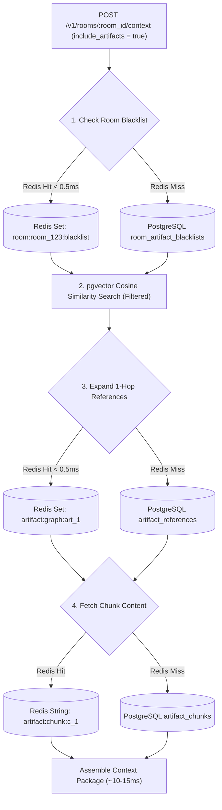

# Redis Caching & Performance Backlog

This document tracks all caching requirements, data structures, and cache invalidation strategies to be implemented during the **Redis Migration Infrastructure Phase**.

---

## 1. Current Non-Redis Engine Architecture (As-Is State)

ContextKit currently runs **without a Redis dependency** (`docker-compose.yml` provisions PostgreSQL `pgvector:pg15`, Go `konteks-app`, and MinIO `minio`).

- **Async Task Execution**: Handled natively in Go via bounded channel worker queues (`chan messageTask`) and goroutine worker pools (`messageUsecase.worker()`).
- **Memory & Room Caching**: Queries execute directly against PostgreSQL 15 with indexes, `sqlx.DB`, and local in-memory Go data structures.
- **Deduplication & Entropy**: Executes inline in Go using Shannon entropy calculations, regex pre-parsers, and `gzip` compression ratio checks (`isSpam`).

---

## 2. Artifact & Core Memory Caching Architecture (Future Redis Phase)

---

## 3. Redis Key Patterns & Data Structures (Future Phase)

### A. Room Blacklist Mask Cache
- **Key Pattern**: `room:{room_id}:blacklist:artifacts` (Redis Set `SADD`)
- **Key Pattern**: `room:{room_id}:blacklist:groups` (Redis Set `SADD`)
- **Purpose**: Microsecond room-level exclusion check before performing vector/graph search.
- **Operations**:
  - `SISMEMBER room:{room_id}:blacklist:artifacts {artifact_id}`
  - Fast Set Difference (`SDIFF`) during query assembly.
- **Invalidation**: On `POST/DELETE /v1/rooms/:room_id/blacklist`, update Redis Set and publish event.

### B. Knowledge Graph Adjacency List Cache
- **Key Pattern**: `artifact:graph:{project_id}:{source_artifact_id}` (Redis Set `SADD`)
- **Purpose**: Fast 1-hop reference edge traversal (resolving linked artifacts without recursive SQL queries).
- **Operations**:
  - `SMEMBERS artifact:graph:{project_id}:{source_artifact_id}`
  - Returns array of target artifact IDs in < 0.5 ms.
- **Invalidation**: When an artifact's Markdown links or YAML frontmatter references change, update Redis Set.

### C. Artifact Content & Chunk Cache
- **Key Pattern**: `artifact:chunk:{chunk_id}` (Redis Hash / String JSON)
- **TTL**: 24 hours (LRU eviction).
- **Purpose**: Avoid reading raw chunk text from PostgreSQL disk during final context package compilation.

---

## 4. Context Health Engine Redis Migration Plan (Future Phase)

When ContextKit scales across multiple backend app instances behind a load balancer, the Context Health Engine will migrate its background task queue and room locks from in-memory Go channels to Redis:

### A. Distributed Micro-Sweep Task Queue
- **Key Pattern**: `context_health:queue:micro_sweeps` (Redis Stream / Asynq Task Queue)
- **Purpose**: Distribute room micro-sweep background jobs across multiple worker nodes.
- **Transition**: Replaces in-memory `chan messageTask` channel when multi-node deployment is enabled.

### B. Distributed Room Health Sweep Lock
- **Key Pattern**: `lock:room:{room_id}:health_sweep` (Redis Key with TTL 30s, `SET NX PX 30000`)
- **Purpose**: Prevent duplicate concurrent LLM contradiction sweeps on the same room across multi-replica deployments.

### C. Fast Payload Deduplication Set
- **Key Pattern**: `room:{room_id}:seen_hashes` (Redis HyperLogLog / Set)
- **Purpose**: O(1) duplicate payload detection prior to PostgreSQL vector queries.
