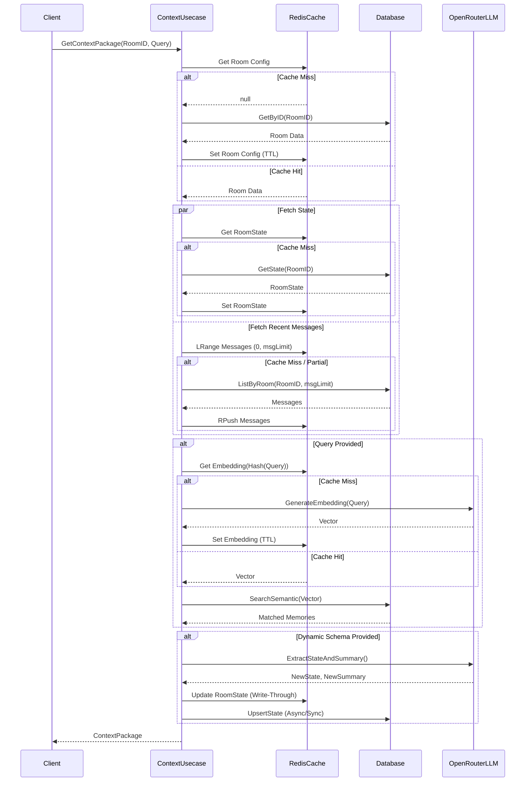

# ContextKit Cache System Design

Based on the current architecture in `context_usecase.go` and `openrouter.go`, ContextKit heavily relies on retrieving historical states, messages, and querying external LLMs for embeddings and extraction. Implementing a cache system will significantly reduce database load, minimize LLM API costs, and lower latency.

## 1. Features to Cache

### A. Room Configuration (`roomRepo.GetByID`)
- **Why**: Room metadata and policies are checked on every `GetContextPackage` call but rarely change.
- **Cache Strategy**: **Read-Through Cache** with a TTL (e.g., 1 hour).
- **Invalidation**: Invalidate upon room configuration updates.

### B. Room State (`roomRepo.GetState`)
- **Why**: The Room State (Summary, Active Topic, JSON State) is critical for context assembly. It is updated often but read on every query.
- **Cache Strategy**: **Write-Through Cache** or **Write-Behind Cache**. When the LLM extracts new state, it is immediately updated in the cache and asynchronously persisted to the DB.

### C. Recent Message History (`messageRepo.ListByRoom`)
- **Why**: `GetContextPackage` frequently pulls the last N messages based on the dynamic strategy (e.g., `msgLimit`). 
- **Cache Strategy**: Use a Redis `List` or `Sorted Set` to hold the most recent messages (e.g., up to 100) per room. Append new messages to the cache in real-time as they are created.

### D. LLM Embeddings (`openRouterClient.GenerateEmbedding`)
- **Why**: Exact identical queries from the same user or similar short queries cost time and tokens to re-embed.
- **Cache Strategy**: **Key-Value Cache** where `Key = Hash(Query)` and `Value = Vector`.
- **TTL**: Long TTL (e.g., 24-48 hours) as embeddings for the exact same string are deterministic.

## 2. Proposed System Design

We propose a **multi-tier caching architecture** using Redis as the primary hot-cache layer.

### Flow Diagram

## 3. Implementation Details

1. **Redis Integration**: Introduce a `CacheProvider` interface in the `domain` package to abstract the caching layer.
2. **Fallback Mechanism**: Always fall back to the PostgreSQL database if Redis is unavailable to ensure high availability.
3. **Write-Through on State**: When `ExtractStateAndSummary` completes, update the Redis cache immediately so subsequent rapid requests get the freshest state, while triggering a background Goroutine to execute `roomRepo.UpsertState` to prevent blocking the HTTP response.
4. **Encryption Handling**: Since the DB stores encrypted data, the cache layer should store the **encrypted** payloads to prevent exposing plain text in the Redis instance. Decryption should still happen within the UseCase layer after fetching from the cache.
