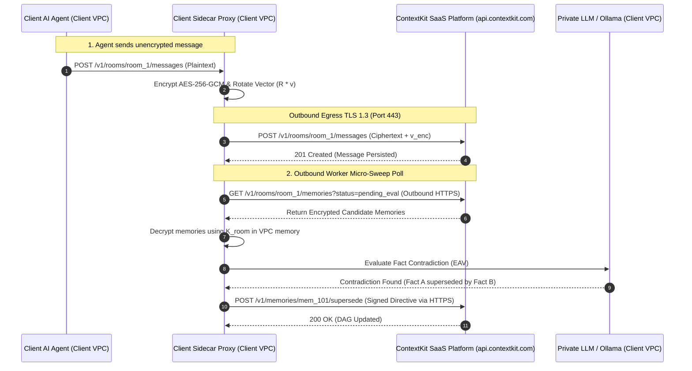

# Architectural Specification: ContextKit Client Sidecar SDK & Zero-Trust Proxy

This document specifies the design for the official **ContextKit Client Sidecar SDK (`sdk/python/`)** and **Sidecar Proxy Container (`sidecar/`)**.

---

## 1. Executive Summary

Modern AI enterprise agents operating in health, finance, and defense require **Zero-Knowledge Context Infrastructure**. While ContextKit server manages storage, vector indexing (`pgvector`), cold storage lifecycle, and temporal recall, it must never possess decryption keys ($\mathbf{K}_{master}$) or raw plaintext payloads.

The **Client Sidecar SDK** sits entirely within the client's cloud VPC (or as an in-process Python package), transparently performing:
1. **Deterministic HKDF Key Derivation** ($\mathbf{K}_{room} = \text{HKDF}(\mathbf{K}_{master}, \text{room\_id})$).
2. **AES-256-GCM Envelope Encryption & Decryption**.
3. **Secret Orthonormal Vector Rotation** ($\mathbf{v}_{enc} = \mathbf{R} \cdot \mathbf{v}$).
4. **Client-Side E2EE Context Health Micro-Sweeps** (Local LLM contradiction evaluation without sending keys to ContextKit server).
5. **Transparent HTTP Sidecar Proxying** listening on port `:8085`.

---

## 2. System Architecture & Component Diagram

```mermaid
flowchart TD
    subgraph Client Application / Kubernetes Pod
        Agent["Client AI Agent Process"] -->|Unencrypted API Call| Proxy["ContextKit Sidecar Proxy (Port 8085)"]
        
        subgraph Sidecar Engine (Client VPC)
            Proxy --> HKDF["HMAC-HKDF Key Manager"]
            Proxy --> Crypto["AES-256-GCM Engine"]
            Proxy --> Rotator["Orthonormal Matrix Rotator R"]
            
            subgraph Client Health Worker
                Worker["Background Contradiction Worker"] --> LocalDec["Local Decryptor"]
                Worker --> PrivateLLM["Client Private LLM or Ollama"]
            end
        end
    end

    subgraph ContextKit Platform Backend (Zero-Knowledge)
        Crypto -->|Base64 AES-256-GCM Container| BackendAPI["ContextKit Go Server (Port 8080)"]
        Rotator -->|Transformed Embedding v_enc| DB[("PostgreSQL pgvector")]
        PrivateLLM -->|Signed Supersedence Directive| BackendAPI
    end

    BackendAPI -->|Encrypted Context Package| Proxy
    Proxy -->|Decrypted Context Package| Agent
```

---

## 3. Core Modules & Component Responsibilities

### 3.1 `contextkit_sdk.crypto` (AES-256-GCM & HKDF Key Manager)
- Derives per-room encryption keys:
  $$\mathbf{K}_{room} = \text{HKDF-Expand}(\mathbf{K}_{master}, \text{"konteks-room-" } \parallel \text{room\_id})$$
- Encrypts payload string to Base64 AES-256-GCM container format (`version`, `alg`, `nonce`, `ciphertext`).
- Decrypts ciphertexts received from server API using $\mathbf{K}_{room}$.

### 3.2 `contextkit_sdk.vector_rotation` (Orthonormal Vector Rotation Engine)
- Generates secret orthonormal rotation matrix $\mathbf{R} \in \mathbb{R}^{d \times d}$ using QR decomposition on random Gaussian matrix ($\mathbf{R}^T \mathbf{R} = \mathbf{I}$).
- Transforms vector embeddings prior to egress:
  $$\mathbf{v}_{enc} = \mathbf{R} \cdot \mathbf{v}$$
- Guarantees 100% exact mathematical cosine distance preservation in PostgreSQL `pgvector`:
  $$\mathbf{u}_{enc} \cdot \mathbf{v}_{enc} = (\mathbf{R}\mathbf{u})^T (\mathbf{R}\mathbf{v}) = \mathbf{u}^T \mathbf{I} \mathbf{v} = \mathbf{u} \cdot \mathbf{v}$$

### 3.3 `contextkit_sdk.health_worker` (Client-Side E2EE Micro-Sweep Worker)
- For E2EE rooms where server cannot read text to resolve contradictions:
  - Worker polls encrypted active memories from ContextKit server.
  - Decrypts candidate memory text locally in client memory.
  - Calls client's private LLM endpoint (Ollama, local vLLM, or private OpenAI model).
  - Submits signed supersedence directives (`POST /v1/memories/:id/restore` or update status) back to server API.

### 3.4 `sidecar/proxy.py` (Transparent Sidecar HTTP Proxy)
- Runs a lightweight AsyncIO / FastAPI server on `http://localhost:8085`.
- Intercepts requests like `POST /v1/rooms/:id/messages` and `POST /v1/rooms/:id/context`.
- Transparently handles encryption, vector rotation, and decryption so legacy AI agent code requires zero code modifications.

---

## 4. Network Connectivity & VPC Topology (Outbound-Only)

> [!IMPORTANT]
> **Zero Inbound Port Requirement**: ContextKit SaaS **NEVER** initiates inbound network connections into the customer's VPC. Customer firewalls require **0 inbound open ports**.



### Egress Connectivity Options for SaaS Customers
1. **Public HTTPS / Egress Gateway (Standard SaaS)**: Sidecar sends standard outbound HTTPS (Port 443) requests to `https://api.contextkit.com`.
2. **AWS PrivateLink / GCP Private Service Connect (Enterprise Zero-Egress)**: Enterprise clients route outbound HTTPS traffic over private ENI endpoints without traversing the public internet.

---

## 5. Implementation Milestones

1. **Milestone 1**: Python SDK Core (`crypto.py`, `vector_rotation.py`, `client.py`, `setup.py`) + Pytest suite.
2. **Milestone 2**: Client Health Micro-Sweep Worker (`health_worker.py`) with Ollama / OpenAI local fallback.
3. **Milestone 3**: Standalone Sidecar Proxy (`sidecar/proxy.py`, `Dockerfile`, `docker-compose.sidecar.yml`).
4. **Milestone 4**: Handover & Quickstart documentation.
