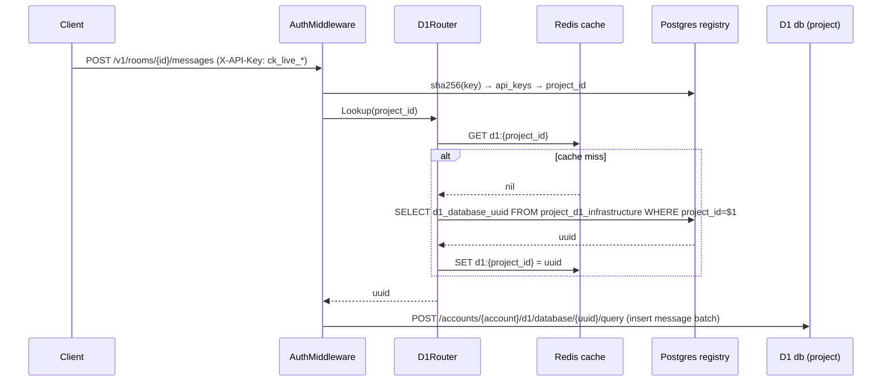

# Plan: Offload Core Chat Data to Per-Project Cloudflare D1

## 1. Context

Multi-tenancy is real: tenants are `projects`, scoped end-to-end by API key → `project_id` (`AuthContext`, `middleware.go:79`). The current single Postgres has already offloaded embeddings to Cloudflare Vectorize (migrations 09–10). This plan pushes the chat *data plane* into per-project D1 databases while keeping the auth/control-plane in Postgres.

**D1 hard constraint:** no distributed/interactive transactions. Mitigation available: a **single `POST /query` call with multiple statements executes atomically** (SQLite implicit transaction over a batch), so any multi-statement write that fits in one call is safe; any write touching *both* Postgres and D1 must become a two-phase, idempotent operation.

## 2. Placement Map (table-by-table)

### Postgres — stays (auth, control plane, metering)

| Table | Why it stays |
|---|---|
| `users`, `project_members`, `project_invitations`, `api_keys` | Global/shared auth, cross-tenant |
| `projects` | Tenant registry — gains D1 infra columns |
| `usage_records` | Billing + cross-project dashboard aggregation |
| `artifact_groups`, `artifacts`, `artifact_chunks`, `artifact_references`, `room_artifact_blacklists` | S3-content-backed KB metadata, low volume (decision: keep in Postgres) |
| `rooms` | **Control-plane hub — see §4 plus/minus** |

### D1 (one database per project) — moves

| Table | Feasibility | Notes |
|---|---|---|
| `messages` | **Doable** | Sequence insert via single-call atomic batch; `UNIQUE(room_id, sequence)` guard |
| `room_state` | **Doable** | `ON CONFLICT (room_id) DO UPDATE` supported by SQLite ≥3.35 |
| `memories` + `memory_revisions` | **Doable** | Embeddings live in Vectorize; hydration must be rewritten (`ANY($1::uuid[])` → per-id fetch) |
| `room_events` | **Doable** | Single-table R/W |
| `context_evaluations` | **Doable** | Single-table R/W |

### Not-doable / heavy adaptation

| Item | Why | Workaround |
|---|---|---|
| Cross-DB transaction (Postgres + D1) | D1 can't join a transaction with Postgres | Two-phase idempotent writes + outbox/retry |
| Cross-project aggregate queries | Each project is a *separate D1 db* — a SQL query can't span dbs | Keep aggregates on Postgres (`usage_records`, `context_evaluations`); app-side fan-out only where needed |
| `messages JOIN rooms` queries | `ListProjectLogs`, `usage_repo.GetSummary` msg-count, `mcp_room.ListByProject` | Decompose into per-DB queries + app-side merge (§7) |
| PG-only SQL | `ANY($1::uuid[])`, `::text/::jsonb`, `ILIKE`, `NOW()` | Rewrite for SQLite (`IN (...)`, plain `LIKE`, `CURRENT_TIMESTAMP`) |
| Vector search in D1 | Not supported | Keep Vectorize as source of truth |

## 3. Project → D1 Mapping (how we guarantee the right db)

**Design rule: the D1 uuid is never client-supplied. It is always derived from the authenticated `project_id`.**

1. **Registry table (Postgres):**
   ```sql
   CREATE TABLE project_d1_infrastructure (
     id              UUID PRIMARY KEY DEFAULT gen_random_uuid(),
     project_id      UUID NOT NULL REFERENCES projects(id) ON DELETE CASCADE,
     d1_database_uuid UUID NOT NULL,
     d1_name         VARCHAR(255) NOT NULL,
     jurisdiction    VARCHAR(8)  NOT NULL DEFAULT 'us',
     status          VARCHAR(20) NOT NULL DEFAULT 'pending', -- pending|provisioned|migrated|failed|deleted
     created_at      TIMESTAMPTZ NOT NULL DEFAULT NOW(),
     updated_at      TIMESTAMPTZ NOT NULL DEFAULT NOW(),
     UNIQUE (project_id)
   );
   ```
2. **Provision on project create** → see Diagram 2 (create D1 via CF `POST /accounts/{id}/d1/database`, name `konteks_<project_id>`, run DDL via `/query`, flip registry to `provisioned`).
3. **Resolve at request time** → `D1Router.Lookup(ctx, projectID)` checks Redis `d1:{project_id}` → registry fallback → returns `d1_database_uuid`. Cache invalidated on provision/delete.
4. **Idempotency:** D1 name derived from `project_id`; provisioning is `create-if-missing` (list by name first).

## 4. `rooms` Placement — Plus/Minus (why it should stay in Postgres)

**Option A — keep `rooms` in Postgres (recommended)**

| Plus | Minus |
|---|---|
| Dashboard `ListWithOverview` (rooms JOIN room_state LEFT JOIN messages-count LEFT JOIN usage_records) stays a single SQL query. Moving rooms would force a fan-out to **every project's D1 db** + app-side merge per dashboard load — O(N projects). | `room_state.room_id` and `rooms.id` now span stores → room create + state upsert need two-phase writes |
| `usage_records.room_id` FK + `GetSummary` stay intra-DB — no cross-store join | 3 queries `JOIN`ing rooms+messages must be decomposed (ListProjectLogs, GetSummary, ListByProject) |
| Archival sweep (`ListRoomsForArchival`, status flips) operates on Postgres without D1 round-trips until the delete phase | Extra "room exists" check before writing to D1 — mitigated by Redis room-existence cache |
| Rooms are write-once control-plane metadata; the actual high-volume write load is messages/memories/events — exactly what we offload | — |
| Tenant isolation (BOLA) at middleware stays unchanged | — |

**Option B — move `rooms` into D1**

| Plus | Minus |
|---|---|
| Chat domain fully co-located → real SQLite joins for context assembly | Dashboard listing breaks (fan-out), `usage_records` loses `room_id` FK integrity, archival must hit D1 first, project room listing becomes per-db queries |

**Recommendation: Option A.** `rooms` is the hub table that platform-side features (dashboard, usage, archival) depend on; it's low-volume and rarely written. Co-locating it with usage/control data costs the least.

## 5. Diagrams

### D1 — Target architecture

```mermaid
graph TD
  Agent[Client Agent / SDK] -->|API keyProjectID| API[ContextKit API Go backend]
  API -->|resolve project_id| MID[AuthMiddleware]
  MID --> PGREG[(Postgres: users, projects, api_keys, project_d1_infrastructure, rooms, usage_records, artifacts)]
  MID -.->|projectID| ROUTER[D1Router: Redis d1:{project_id} -> uuid]
  ROUTER --> D1A[(D1 db project A<br/>messages, room_state, memories, room_events, context_evaluations)]
  ROUTER --> D1B[(D1 db project B ...)]
  API -->|control-plane writes| PGREG
  API -->|chat reads/writes| D1A
  D1A -.->|batch atomic| API
  API --> VEC[Cloudflare Vectorize: embeddings]
  API --> S3[(S3/MinIO: archives, artifacts)]
```

### D2 — D1 provisioning lifecycle

```mermaid
flowchart TD
  Start[Create Project] --> T[Postgres tx: insert projects + members]
  T --> P[Provisioner: GET d1/database?name=konteks_<pid>]
  P --> C{Exists?}
  C -->|no| CREATE[POST d1/database create]
  CREATE --> REG[Bootstrap registry row status=provisioned]
  C -->|yes| REUSE[Reuse existing uuid]
  REUSE --> REG
  REG --> DDL[POST /query: run D1 DDL migrations]
  DDL --> MK[migrated: flip registry status]
  MK --> INV[Invalidate Redis d1:{pid}]
  INV --> DONE[Ready for cutover]
```

### D3 — Request-time routing (guarantee correct db)



### D4 — Transaction decomposition (Postgres tx → idempotent two-phase)

```mermaid
flowchart TB
  subgraph Message Create (D1-only, atomic)
    M1[Verify room exists in Postgres - cached]
    M2[One /query call: INSERT ... SET seq = COALESCE(MAX(sequence),0)+1 WHERE room_id=$1]
    M3[Conflict on UNIQUE(room_id,sequence) -> retry]
  end
  subgraph Room Create (cross-DB)
    R1[Postgres tx: insert rooms]
    R2[D1 call: INSERT room_state {}]
    R3[Fail between R1/R2? state read-path already tolerates nil room_state - compensated lazily]
  end
  subgraph State Upsert (cross-DB, eventual)
    S1[D1 UPSERT room_state - authoritative]
    S2[Postgres best-effort UPDATE rooms.updated_at - ignorable]
  end
  subgraph Archival (cross-DB, idempotent)
    A1[Postgres: rooms status=archiving]
    A2[S3: upload archive]
    A3[D1 batch /query: DELETE messages keep last 3 + DELETE memories - atomic]
    A4[Postgres: rooms status=archived + archive_s3_path]
    A5[Retry any failed step - all steps idempotent by status checks]
  end
```

### D5 — Backfill / migration (existing projects)

```mermaid
flowchart LR
  GATE[Provision D1 for every existing project - from registry]
  EXP[Per project: stream rooms→messages→room_state→memories from Postgres]
  GEN[Generate SQL insert script per project]
  IMP[CF /import: init → upload to presigned R2 URL → ingest → poll]
  VER[Verify row-count parity]
  CUT[Flip per-project read-path to D1 (feature flag)]
  DROP[After all projects cut over: drop chat tables in Postgres]
  GATE-->EXP-->GEN-->IMP-->VER-->CUT-->DROP
```

## 6. Implementation Stages

1. **D1 client layer** — `repository/d1_client.go` wrapping CF D1 REST (`/query`, `/raw`, `/import`, `/export`), reusing the existing Vectorize HTTP/auth pattern (`cloudflare_vectorize_store.go`). SQLite-safe query builder.
2. **Registry + D1Router + config** — `project_d1_infrastructure` migration, Redis cache, `Lookup(projectID)`, provisioning job on project create.
3. **D1 repositories** — port `message_repo` (sequence batch), `room_state`/`mcp_state`, `memory_repo`/`mcp_memory` (Vectorize + ID hydration), `event_repo`, `evaluation_repo`.
4. **Decompose the 3 straddle queries** — `ListProjectLogs`, `usage_repo.GetSummary` msg-count, `mcp_room.ListByProject`: D1-side per-room queries + Postgres-side merges.
5. **Archival + workers** — port `ArchiveRoomTx` to two-phase flow; align `worker/archiver.go` and background compaction on D1.
6. **Backfill tooling** (`cmd/d1_migrator`) — per-project export→import→verify→cutover (Diagram 5).

## 7. Open Decision (for you) — deployment target & latency

Your Go backend runs off-Workers (docker-compose). Every D1 op becomes a CF REST `/query` call:

- **Read path cost:** context assembly does ~5–7 DB round-trips today; as REST calls that's ~40–150ms *each*. If a <100ms p95 context-package is required, REST-D1 from an external backend won't hold.
- **Options:** (a) accept latency on chat-tolerant paths (ingestion, compaction), keep Postgres for sync-critical dashboard/usage reads — **recommended hybrid**; (b) run on Cloudflare Workers for native D1 bindings (single-digit ms, no REST hop) — larger architecture change; (c) keep everything as-is.
- **Scale caps:** D1 ~10GB/db, per-account database limits — each project consumes one D1 db, so account capacity buffers must be planned; enable `read_replication: auto` for read-heavy projects.

**No hard blockers.** Every current transaction (`message_repo.Create`, `mcp_room.Create`, `auth_repo.CreateProject`, `artifact_repo.CreateChunks`, `ArchiveRoomTx`) is single-DB today and maps to either a D1 atomic batch or a two-phase idempotent flow.

---

## Appendix A: Migration Order for Existing Projects

1. **Bulk provision** D1 dbs for all active projects in parallel (bounded by CF API rate limits).
2. **Validate registries** (rows exist with status=`provisioned`, UUID non-null).
3. **Run D1 migration script** on each newly provisioned D1 db (`01_init.sql` with chat tables only, no auth tables).
4. **Backfill** each project one at a time (parallel batches). Export rows in the same order they appear in Postgres to preserve primary-key integrity (rooms → messages → room_state → memories).
5. **Feature flag** `d1-backfill-complete` per project to turn on the D1 read path while still falling back to Postgres if needed.
6. **Promote all projects** to full D1 — after verification window, drop chat tables in Postgres.

## Appendix B: Error Handling & Idempotency Patterns

- **Provisioning retries:** If CF API returns 409 (db already exists), read UUID from registry and continue; if status=`failed`, delete orphan entry and retry.
- **Message sequence insertion:** D1 batch with `SELECT MAX(sequence) FROM messages WHERE room_id=$1` subquery + `INSERT ... SELECT ...` ensures atomic sequence assignment per room (D1 serializes writers per db). Add `UNIQUE(room_id, sequence)` constraint to detect concurrent insertion collisions and retry.
- **Room create two-phase:** Postgres tx creates rooms row first. If D1 state creation fails, cache a retry task; GetState already returns default empty state, so missing state row is tolerable.
- **State upsert two-phase:** D1 UPSERT room_state first. Postgres rooms.updated_at is updated best-effort in background (non-critical, sorting uses existing updated_at order; staleness acceptable).
- **Archival two-phase:** Steps are idempotent (status checks: `archiving → archived`, `archive_s3_path` set once). Use outbox/queue to retry any failed step; on re-entry, skip already-done actions.

## Appendix C: Dependencies on Cloudflare API Changes

- **D1 API endpoints used:**
  - `GET /accounts/{account}/d1/database` — list dbs by name to detect existence
  - `POST /accounts/{account}/d1/database` — create db with `name`, `jurisdiction`, `primary_location_hint`
  - `GET /accounts/{account}/d1/database/{uuid}` — fetch registry row
  - `POST /accounts/{account}/d1/database/{uuid}/query` — single SQL batch
  - `POST /accounts/{account}/d1/database/{uuid}/raw` — raw row-returning
  - `POST /accounts/{account}/d1/database/{uuid}/import` — bulk load SQL dump
  - `POST /accounts/{account}/d1/database/{uuid}/export` — snapshot for verification
- **Verify Cloudflare account limits:** per-account database limits, per-database storage caps (10GB default). Plan to monitor usage and provision additional D1 dbs if needed.