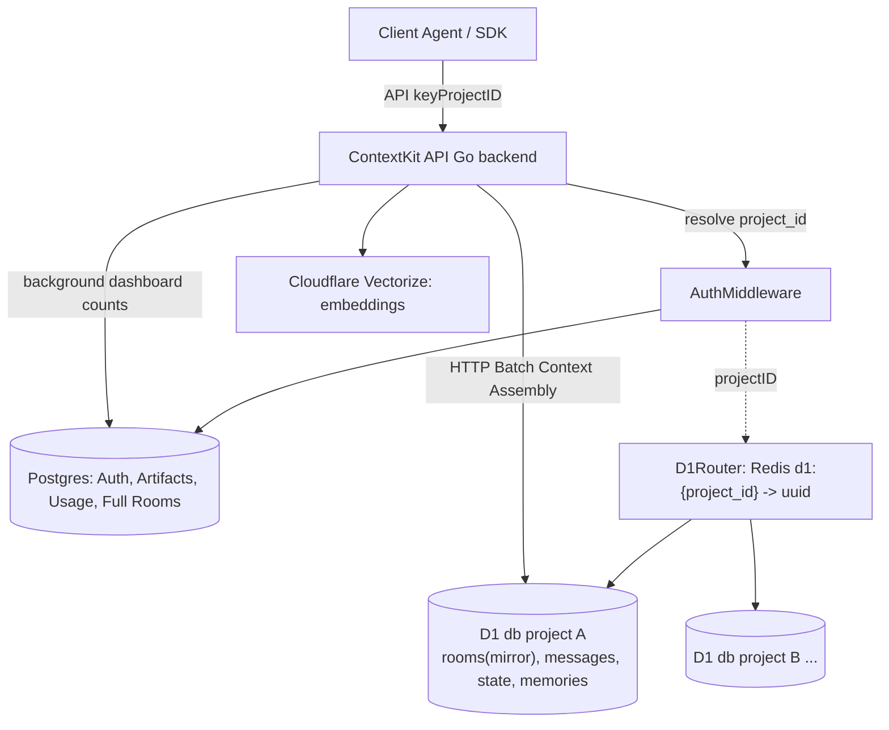
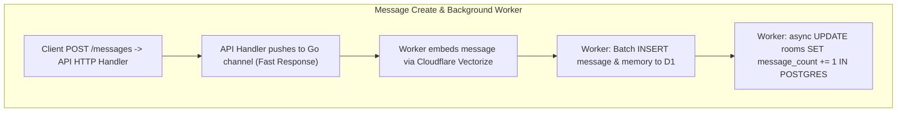
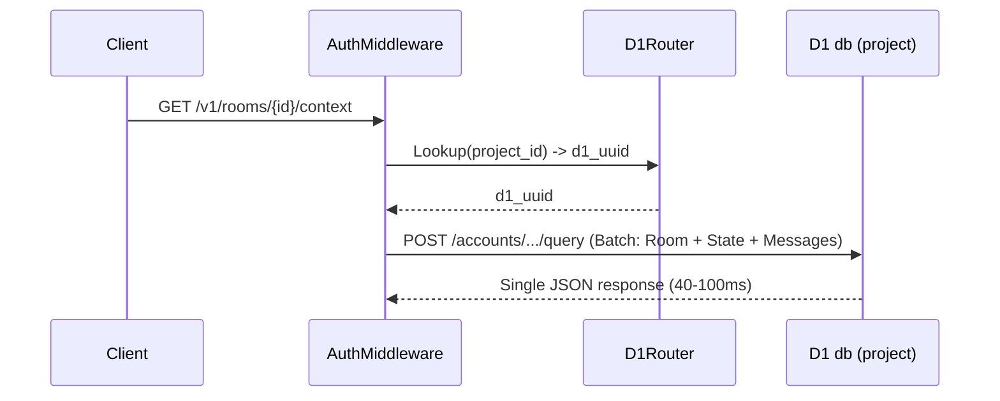

# Plan: Offload Core Chat Data to Per-Project Cloudflare D1 (Denormalized Architecture)

## 1. Context

Multi-tenancy is real: tenants are `projects`, scoped end-to-end by API key → `project_id`. The current single Postgres has already offloaded embeddings to Cloudflare Vectorize (migrations 09–10) and has a clean, SQLite-compatible schema (no Postgres-specific array types or pgvector dependencies). This plan pushes the chat *data plane* into per-project D1 databases while keeping the auth/control-plane in Postgres.

**D1 hard constraint:** no distributed/interactive transactions over HTTP. Mitigation available: a **single `POST /query` call with multiple statements executes atomically in a batch**. To bypass D1 HTTP latency and solve pagination limitations, this architecture uses **strategic denormalization** (duplicating `rooms` data).

## 2. Placement Map (table-by-table)

### Postgres — (Auth, Control Plane, and Dashboards)

| Table | Why it stays |
|---|---|
| `users`, `project_members`, `project_invitations`, `api_keys` | Global/shared auth, cross-tenant |
| `projects` | Tenant registry — gains D1 infra columns |
| `usage_records` | Billing + cross-project dashboard aggregation |
| `artifact_groups`, `artifacts`, `artifact_chunks`, `artifact_references`, `room_artifact_blacklists` | S3-content-backed KB metadata, low volume |
| `rooms` | **Dashboard Hub** — Gains `message_count` and `last_message_at` to retain perfect SQL pagination/sorting for `ListRoomsOverview` without querying D1. |

### D1 (one database per project) — (Chat Data Plane)

| Table | Notes |
|---|---|
| `rooms` (Mirror) | Denormalized stripped copy (`id`, `status`, `default_policy`, `external_user_id`). Eliminates the need to query Postgres during context assembly. |
| `messages` | Sequence insert via single-call atomic batch. |
| `room_state` | `ON CONFLICT (room_id) DO UPDATE` supported by SQLite ≥3.35. |
| `memories` + `memory_revisions` | Embeddings live in Vectorize; IDs stored here. |
| `room_events` | Single-table R/W. |
| `context_evaluations` | Single-table R/W. |

## 3. The Denormalization Solutions (Fixing the Bottlenecks)

### Bottleneck A: The Pagination Deathblow
If `rooms` lives in Postgres and `messages` in D1, sorting rooms by "most recent message" or "min 10 messages" requires fetching everything in memory.
* **The Fix:** Add `message_count` (INT) and `last_message_at` (TIMESTAMP) to Postgres `rooms`. When a background worker saves a message to D1, it fires an asynchronous `UPDATE rooms SET message_count = message_count + 1...` to Postgres.
* **Result:** `ListRoomsOverview` remains a 1ms Postgres query.

### Bottleneck B: Context Assembly Latency
Fetching a Postgres Room (15ms), then asking D1 for State (75ms), then asking D1 for Messages (75ms) creates an unacceptable ~160ms+ Time-To-First-Token (TTFT) delay.
* **The Fix (Room Mirroring):** Because D1 has a mirrored copy of the `rooms` table, we don't query Postgres at all on the read path. We lookup the D1 UUID in Redis and send **one single HTTP Batch Request**:
  ```sql
  SELECT * FROM rooms WHERE id = ?;
  SELECT * FROM room_state WHERE room_id = ?;
  SELECT MAX(sequence) FROM messages WHERE room_id = ?;
  SELECT * FROM messages WHERE room_id = ? ORDER BY sequence DESC LIMIT ?;
  ```
* **Result:** Cloudflare executes all queries in microseconds and returns a single JSON payload. Latency is capped at **40-100ms flat**.

## 4. Project → D1 Mapping (how we guarantee the right db)

**Design rule: the D1 uuid is never client-supplied. It is always derived from the authenticated `project_id`.**

1. **Registry table (Postgres):**
   ```sql
   CREATE TABLE project_d1_infrastructure (
     id              UUID PRIMARY KEY DEFAULT gen_random_uuid(),
     project_id      UUID NOT NULL REFERENCES projects(id) ON DELETE CASCADE,
     d1_database_uuid UUID NOT NULL,
     d1_name         VARCHAR(255) NOT NULL,
     jurisdiction    VARCHAR(8)  NOT NULL DEFAULT 'us',
     status          VARCHAR(20) NOT NULL DEFAULT 'pending',
     created_at      TIMESTAMPTZ NOT NULL DEFAULT CURRENT_TIMESTAMP,
     updated_at      TIMESTAMPTZ NOT NULL DEFAULT CURRENT_TIMESTAMP,
     UNIQUE (project_id)
   );
   ```
2. **Resolve at request time** → `D1Router.Lookup(ctx, projectID)` checks Redis `d1:{project_id}` → returns UUID.

## 5. Diagrams

### D1 — Target Architecture



### D2 — Background Message Processing (Pagination Fix)



### D3 — Context Assembly (Latency Fix)



## 6. Implementation Stages

1. **Schema Tweaks:** Add `message_count` and `last_message_at` to Postgres `rooms`. Add stripped `rooms` table to D1. Replace `NOW()` with `CURRENT_TIMESTAMP` and `ANY()` with `json_each` in Go repo queries.
2. **D1 client layer:** Create `repository/d1_client.go` wrapping CF D1 REST (`/query` batches).
3. **Repository Refactor:** Rewrite `roomRepo`, `messageRepo`, and `contextUsecase` to use HTTP Batches (`db.Batch()`) instead of Postgres `BeginTxx()`.
4. **Archival & Hydration:** Convert `HydrateRoomTx` into a massive D1 Batch array instead of Go-driven loops. 
5. **Backfill tooling:** Export per-project PG data, generate D1 insert batches, upload to D1 `/import`.