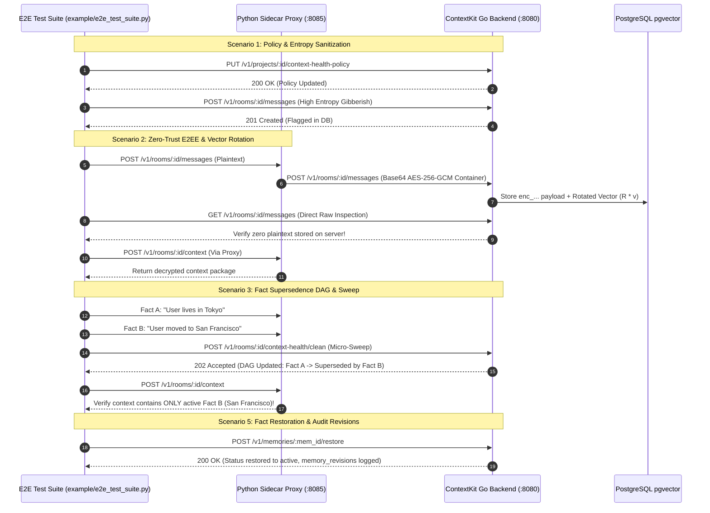

# E2E Testing Plan Specification: Context Health & Zero-Trust E2EE Sidecar

This document specifies the end-to-end (E2E) testing framework for validating ContextKit's **Context Health Engine**, **Zero-Trust E2EE Sidecar Proxy**, **Vector Rotation**, and **Fact Supersedence DAG**.

---

## 1. Test Architecture & Harness Flow



---

## 2. Test Scenarios Matrix

| Scenario | Objective | Target Endpoint | Success Criteria |
| :--- | :--- | :--- | :--- |
| **1. Entropy Sanitization** | Verify high-entropy noise flagging & technical whitelist bypass | `POST /v1/rooms/:id/messages` | High-entropy text flagged; code/API keys whitelisted |
| **2. Zero-Trust E2EE** | Verify zero plaintext on server DB & transparent proxy decryption | `http://localhost:8085` vs `http://localhost:8080` | `enc_...` payload in DB; decrypted text in proxy response |
| **3. Supersedence DAG** | Verify LLM EAV contradiction resolution supersedes outdated facts | `POST /v1/rooms/:id/context-health/clean` | Fact A status = `superseded`; active query returns only Fact B |
| **4. Temporal Recall** | Verify deterministic relative time query bounds (*"8 months ago"*) | `POST /v1/rooms/:id/context` | Temporal parser extracts bounds & returns historical facts |
| **5. Memory Restoration** | Verify manual memory restoration & audit log creation | `POST /v1/memories/:id/restore` | Status transitions to `active`; `memory_revisions` logged |

---

## 3. Running the E2E Test Suite

### Step 1: Start ContextKit Platform Services
```bash
docker compose up -d --build
```

### Step 2: Start Python Sidecar Proxy
```bash
./venv/bin/python sidecar/proxy.py
```

### Step 3: Run E2E Test Suite
```bash
./venv/bin/python example/e2e_test_suite.py
```
