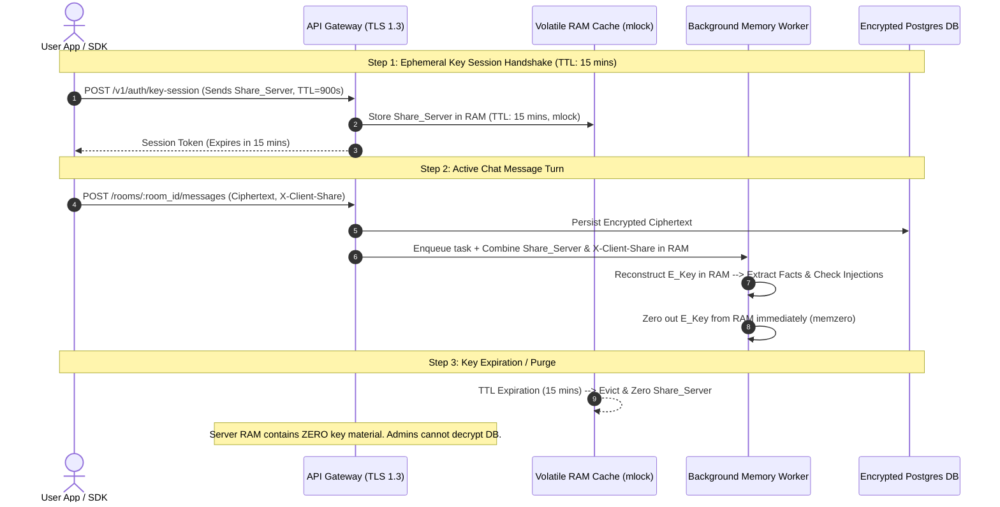

# Ephemeral Time-Bound Key Delegation & Admin-Blind Protection Architecture

Detailed architectural plan for **Ephemeral Key Delegation**, allowing ContextKit to safely inspect and extract memory from encrypted conversations during an active user session while ensuring that **system admins cannot read or reuse keys to decrypt user data**.

---

## 1. Architectural Principles & Guarantees

> [!IMPORTANT]
> 1. **Time-To-Live (TTL) Key Delegation**: The user delegates an ephemeral encryption key (`E_Key`) to ContextKit for a strict time window (e.g., 15 minutes). When the TTL expires, the key is automatically purged from memory.
> 2. **Zero Disk Persistence**: Encryption keys are **never** written to database tables, disk storage, swap space, or server logs.
> 3. **Admin-Blind Protection (Split-Key Cryptography & Secure Enclaves)**: System administrators with root/SSH access to ContextKit servers cannot reconstruct or reuse keys to decrypt database content.

---

## 2. Admin-Blind Protection Mechanisms

### Mechanism 1: Split-Key Threshold Cryptography (Recommended Primary Defense)

Rather than storing the full user key `E_Key` in ContextKit server memory, the key is split into two cryptographic shares using Shamir Secret Sharing / XOR splitting:

$$\text{E\_Key} = \text{Share}_{\text{Server}} \oplus \text{Share}_{\text{Client}}$$

1. **Server Share ($\text{Share}_{\text{Server}}$)**: Held in volatile server RAM with a strict TTL timer (e.g., 15 minutes).
2. **Client Share ($\text{Share}_{\text{Client}}$)**: Sent dynamically in the request header (`X-Client-Share`) **only when the user actively makes API calls**.

#### Why System Admins Cannot Decrypt User Messages:
- If a server administrator SSHs into the machine, dumps RAM, or accesses database backups, they only find $\text{Share}_{\text{Server}}$, which is **cryptographically useless random noise** without $\text{Share}_{\text{Client}}$.
- As soon as the user closes their app session or the TTL expires, $\text{Share}_{\text{Server}}$ is zeroed in RAM (`memzero`), rendering past database ciphertexts permanently un-decryptable by anyone without the client.

---

### Mechanism 2: Enclave / KMS Envelope Encryption (Hardware Isolation)

For enterprise deployments:
- Ephemeral keys are wrapped using a Hardware Security Module (AWS KMS / HashiCorp Vault Transit Engine / SGX Enclave).
- Decryption operations occur inside an isolated enclave process memory space (`mlock` pinned).
- System administrators cannot attach debuggers (`gdb` / `ptrace`) to enclave memory spaces.

---

## 3. Ephemeral Key Delegation Lifecycle (Sequence Diagram)

---

## 4. Security & Safety Checklist

| Threat Vector | Mitigation | Guarantee |
| :--- | :--- | :--- |
| **System Admin SSH / Memory Dump** | Split-Key Cryptography ($\text{Share}_{\text{Server}} \oplus \text{Share}_{\text{Client}}$). | Admin RAM dump yields useless 128-bit random noise. |
| **Log Leakage** | Strict log masking. Keys sanitized from stack traces & debuggers. | Zero key material in application logs. |
| **Disk Swap Leakage** | `mlock` POSIX system call prevents kernel from swapping key memory pages to disk. | Keys stay 100% in physical RAM. |
| **Stale Key Persistence** | Automatic TTL eviction timer + explicit `memzero` wipe on process exit. | Keys auto-destruct after session expiry. |

---

## 5. System Trade-Offs

### **Pros (Pluses)**:
- **Enables Approach A (Active Guardrails)**: ContextKit can safely perform in-memory context poisoning inspection and fact extraction during active user turns.
- **Strict Admin-Blind Privacy**: System admins, DB operators, and hosting providers have zero ability to decrypt user chat logs in PostgreSQL.
- **User Control**: Users can revoke the key session anytime (`DELETE /v1/auth/key-session`), instantly rendering past message ciphertexts unreadable.

### **Cons (Minuses / Trade-offs)**:
- **Re-Authentication Requirement**: Integration clients must refresh the ephemeral key session periodically (e.g. every 15 mins).
- **Background Worker Timing Window**: Async background tasks must complete before `Share_Server` TTL expires.
