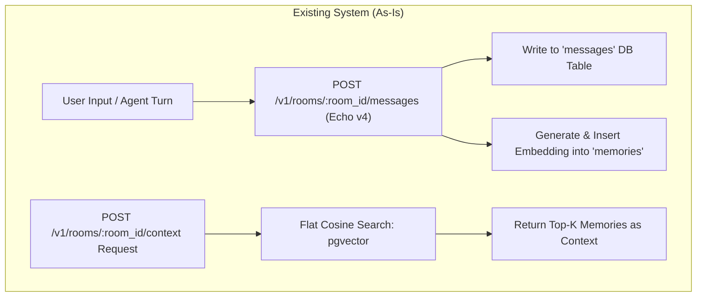
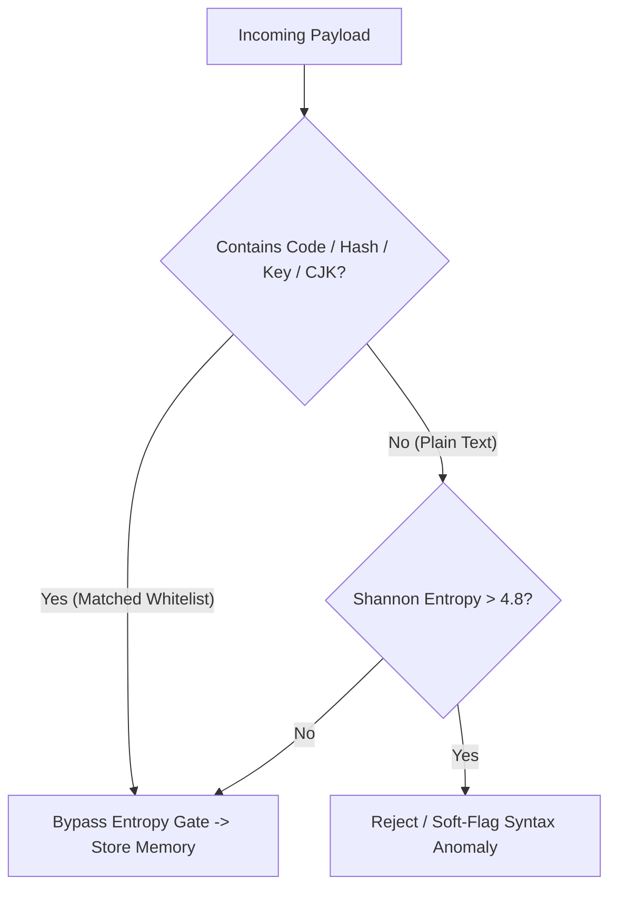
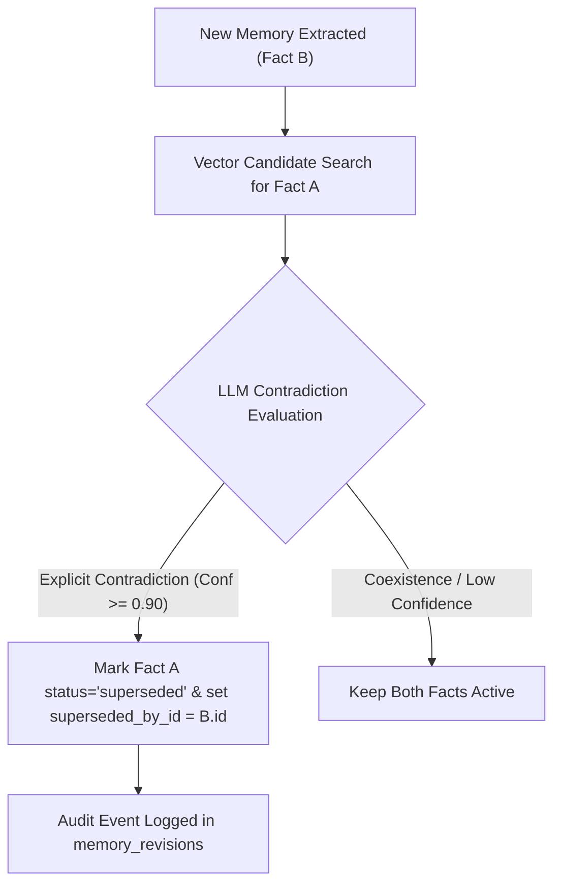
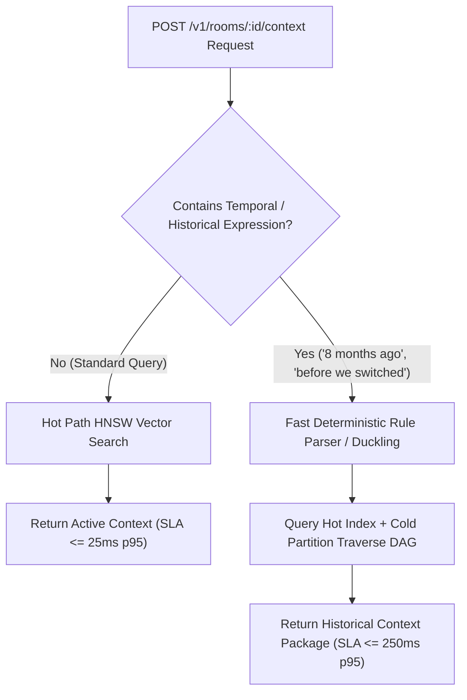

# Product Requirement Document (PRD): Context Pollution Mitigation & Stale Knowledge Lifecycle

**Document Status**: In Review (Updated & Aligned with Backend Go Implementation)  
**Target Component**: ContextKit Engine (`backend/internal/domain`, `backend/internal/usecase`, `pgvector`)  
**Feature Flag**: `context_health_policy` (Project-Level Toggle)

---

## 1. Executive Summary & Product Objective

ContextKit provides vector-based semantic retrieval (`pgvector`) and room state management for AI agents. As conversation rooms scale over extended timelines (months to years), two critical operational failures occur:
1. **Context Pollution / Memory Flooding**: Adversarial or noisy inputs (high-entropy junk, prompt injections, repetitive text) corrupt top vector search results, displacing authentic context.
2. **Stale / Conflicting Knowledge**: Superseded user facts (e.g. `"User lives in Tokyo"` replaced by `"User moved to San Francisco"`) persist alongside active state. Vector retrieval fetches both, causing LLM hallucinations and contradictory agent responses.

**Objective**: Build a robust, cost-controlled **Context Health Engine** that filters memory noise, maintains a version-linked **Supersedence DAG** for fact lifecycle management, supports historical recall (1-year rooms / 8-month queries) with tiered SLAs, and provides mathematically honest **Vector Pseudonymization** for encrypted environments without introducing silent data loss or security vulnerabilities.

---

## 2. As-Is vs. To-Be Architecture & Gap Analysis

### 2.1 Current System (As-Is State)



### 2.2 System Architecture Evolution

```
+-----------------------------------------------------------------------------------+
| AS-IS SYSTEM                                                                      |
|  [Ingress] ---> Echo v4 Direct Write to DB (No Noise / Injection Filtering)      |
|  [Storage] ---> Flat Unversioned Memories Table                                  |
|  [Retrieval] -> Unfiltered Top-K Vector Search (Conflict Prone)                  |
|  [Queue] -----> In-Memory Go Channel (taskQueue chan messageTask)                |
|  [Security] -> Claims 'Zero-Trust E2EE' on Rotated Vectors (Cryptographic Flaw)   |
+-----------------------------------------------------------------------------------+
                                        |
                                        v REFACTORED TO
+-----------------------------------------------------------------------------------+
| TO-BE SYSTEM (With Context Health Engine PRD)                                     |
|  [Ingress] ---> Fast-Path Syntax Anomaly Gate + Egress XML Sandboxing             |
|  [Storage] ---> Versioned Memory DAG (Active vs Superseded State + Audit Trail)   |
|  [Worker] ----> Extended Go Goroutine Worker Pool (Dirty-Room Hibernation Model)  |
|  [Retrieval] -> Tiered SLA Retrieval (Hot: <=25ms, Historical/Temporal: <=250ms)   |
|  [Security] -> Distance-Preserving Vector Pseudonymization + Bucketed Metadata    |
|  [Control] ---> Honest Mode Enums (Explicit Capability Cliff for Cost-Optimized)  |
+-----------------------------------------------------------------------------------+
```

---

## 3. Detailed Architectural Improvements & Threat Model Realities

### 3.1 Addressing Real Prompt Injections vs Syntax Anomaly Filtering

- **The Threat Realities**: Real prompt injections are written in natural, coherent English designed to rank high in semantic search. A simple Shannon entropy check ($>4.8$) **does not stop prompt injections**; it only catches random gibberish. Furthermore, naive entropy gates produce **false positives** on legitimate high-entropy technical content (UUIDs, API keys, Base64 blobs, code snippets, CJK text).
- **Refactored Ingress & Egress Architecture**:
  1. **Syntax Anomaly Detector (Fast-Path)**: Shannon entropy checks are strictly restricted to prose text fields. **Code blocks, Base64 strings, API keys, UUIDs, and CJK scripts are explicitly whitelisted** using regex detectors before entropy evaluation.
  2. **Prompt Injection Mitigation (Egress Sandboxing)**: Prompt injections are neutralized at context packaging time using strict **XML Sandboxing** (`<user_memory trust_level="untrusted">`) and instruction isolation prompts in `GetContextPackage`.



---

### 3.2 Honest E2EE Security Model: Distance-Preserving Vector Pseudonymization

> [!WARNING]
> **Cryptographic Clarification**: Applying an orthonormal rotation matrix ($\mathbf{v}_{enc} = \mathbf{R} \cdot \mathbf{v}$) preserves cosine distance ($\mathbf{u}_{enc} \cdot \mathbf{v}_{enc} = \mathbf{u} \cdot \mathbf{v}$). This property makes rotated vectors vulnerable to **Procrustes Alignment & Embedding Inversion Attacks** if the underlying embedding model (OpenAI, Voyage, Cohere) is known. Therefore, rotation is classified as **Distance-Preserving Vector Pseudonymization (DPVP)**, NOT Zero-Trust Encryption.

#### Security & Compliance Specification

| Component | Protection Level | Threat Model / Attacker Capability |
| :--- | :--- | :--- |
| **Message Payload** | **AES-256-GCM E2EE** | Zero-Knowledge. Server cannot decrypt ciphertext without $\mathbf{K}_{room}$. |
| **Vector Embedding** | **Distance-Preserving Pseudonymization ($\mathbf{R} \cdot \mathbf{v}$)** | Obfuscates casual database inspection. Resistant to raw text lookup, but vulnerable to Procrustes alignment if attacker owns large vector store + public model. |
| **Operational Metadata** | **Bucketed / Anonymized Metadata** | `token_length` is **bucketed** (`0-128`, `129-512`, `513-2048`) to eliminate side-channel length leakage. |

---

### 3.3 Fact Supersedence & Contradiction Resolution

#### Contradiction Engine Specifications
Deciding whether Fact B supersedes Fact A versus coexisting with it is a high-risk operation. False supersession (silently marking a valid fact inactive) causes permanent context loss.



#### Contradiction Extraction Rules
1. **Entity-Attribute-Value (EAV) Matching**: Fact B only supersedes Fact A if both share identical Entity and Attribute (e.g. `(User, Address, "San Francisco")` vs `(User, Address, "Tokyo")`).
2. **High Confidence Threshold ($\ge 0.90$)**: If the LLM evaluator is uncertain, both facts remain active.
3. **User Auditability & Manual Override API**:
   - Superseded facts are **never hard-deleted**.
   - Developers can fetch room memory history including superseded items via `GET /v1/rooms/:room_id/memories?include_superseded=true`.
   - Developers can restore a false-superseded fact using `POST /v1/memories/:memory_id/restore`.

---

### 3.4 Tiered Retrieval SLAs & 1-Year / 8-Month Historical Recall

To prevent latency NFR conflicts, ContextKit defines **two explicit Retrieval SLAs**:



#### Latency SLA Specification

| Query Type | Target SLA (p95) | Retrieval Pipeline | Index Scope |
| :--- | :--- | :--- | :--- |
| **Standard Context Search** | **$\le 25\text{ms}$** | Hot path `pgvector` HNSW search with `WHERE status = 'active'` | Primary active index |
| **Temporal / Historical Recall** | **$\le 250\text{ms}$** | Deterministic temporal grammar parser + Cold storage DAG traversal | Active index + Cold historical partitions |

---

### 3.5 Project Configuration & Explicit Capability Matrix

#### Configuration Options Schema (`backend/db/migrations/07_add_context_health_settings.sql`)
```sql
ALTER TABLE projects 
ADD COLUMN IF NOT EXISTS context_health_policy JSONB DEFAULT '{
  "enabled": true,
  "mode": "balanced",
  "decay_half_life_days": 30,
  "max_entropy_threshold": 4.8,
  "turn_eval_interval": 50,
  "deduplication_threshold": 0.95,
  "e2ee_eval_location": "server_distance_only"
}'::jsonb NOT NULL;
```

#### Explicit Capability Matrix

| Feature Capability | `mode: "strict"` | `mode: "balanced"` (Default) | `mode: "cost_optimized"` | `mode: "off"` |
| :--- | :---: | :---: | :---: | :---: |
| **Syntax Anomaly Filtering** | Strict ($>4.5$) | Standard ($>4.8$) | Standard ($>4.8$) | Disabled |
| **Fact Contradiction Extraction (LLM)** | Every 25 turns | Every 50 turns | **DISABLED** | Disabled |
| **Supersedence DAG Construction** | Active | Active | **DISABLED** | Disabled |
| **Recency-Faded Vector Search (SQL Math)** | Active | Active | **Active Only** | Disabled |
| **LLM Token Overhead** | Higher ($<5\%$) | Low ($<3\%$) | **\$0.00 (Zero LLM Costs)** | \$0.00 |

---

## 4. API Extensions & Operations

### 4.1 Update Project Policy
- **`PUT /v1/projects/:project_id/context-health-policy`**

### 4.2 Audit & Restore Memory Endpoint
- **`GET /v1/rooms/:room_id/memories?include_superseded=true`**
- **`POST /v1/memories/:memory_id/restore`**

### 4.3 Trigger Manual Cleanup Pass
- **`POST /v1/rooms/:room_id/context-health/clean`**

---

## 5. Non-Functional Requirements & Side Effect Controls

1. **Whitelisting & False-Positive Guardrails**: Regex pre-parsers whitelist code blocks, UUIDs, Base64 strings, API keys, and CJK characters before syntax entropy checks.
2. **Auditability**: All supersedence actions write an immutable record to `memory_revisions` table.
3. **E2EE Marketing Compliance**: Architecture and customer documentation explicitly label vector security as *Distance-Preserving Pseudonymization*, avoiding misleading E2EE claims.
4. **Load & Cost Controls**: `strict` mode sweeps ($N=25$) enforce a maximum background worker queue rate-limit to prevent LLM API cost spikes under concurrent load.

---

## 6. Verification & Test Plan

1. **Entropy & Whitelist Tests**: Verify code snippets, API keys, Base64 strings, and CJK text pass ingress without false-positive rejections (`backend/internal/service/entropy_test.go`).
2. **Contradiction & Restore Tests**: Validate entity-attribute matching, DAG creation, and memory restoration via `POST /memories/:id/restore`.
3. **SLA Benchmarks**: Validate standard queries return in $\le 25\text{ms}$ and historical temporal queries return in $\le 250\text{ms}$.
