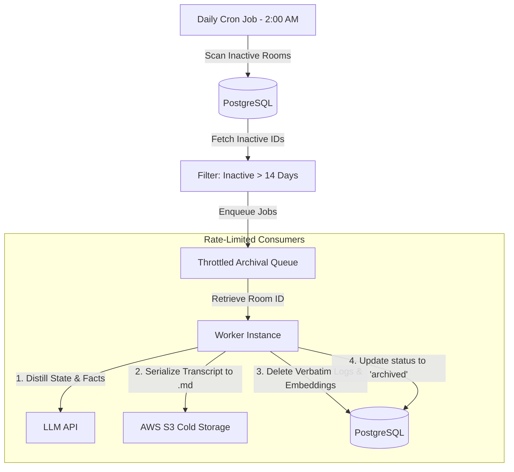
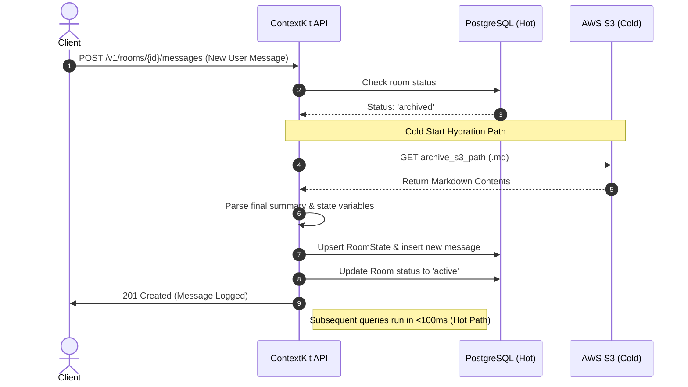

# Future Production Durability Implementation Notes

To guarantee 100% task execution durability (preventing any loss of background embedding generation or state updates if the server crashes or restarts), the following options are planned for a production deployment:

## Option A (Redis Queue)
- **Concept**: Offload background tasks from memory channels to a persistent Redis-backed task queue.
- **Tools**: Use a Go task scheduling library like [hibiken/asynq](https://github.com/hibiken/asynq) or [adjust/rmq](https://github.com/adjust/rmq) backed by Redis.
- **Workflow**:
  1. `CreateMessage` writes message synchronously to PostgreSQL.
  2. `CreateMessage` enqueues a background job payload to Redis.
  3. Bounded workers running on separate consumer instances pull jobs from Redis and execute state extraction/embeddings.
  4. Redis guarantees task delivery even if a worker node crashes mid-execution.

## Option B (Database Outbox Pattern)
- **Concept**: Commit the task logs to a relational table in the same database transaction as the message write.
- **Workflow**:
  1. Create a `context_tasks` table in PostgreSQL:
     ```sql
     CREATE TABLE context_tasks (
         id UUID PRIMARY KEY,
         room_id UUID NOT NULL,
         task_type TEXT NOT NULL,
         payload JSONB NOT NULL,
         status TEXT NOT NULL DEFAULT 'pending', -- pending, processing, completed, failed
         attempts INT DEFAULT 0,
         created_at TIMESTAMP DEFAULT NOW(),
         processed_at TIMESTAMP
     );
     ```
  2. Inside a database transaction:
     - Insert message into `messages` table.
     - Insert extraction task into `context_tasks` table.
  3. A background process (ticker/sweeper) polls the `context_tasks` table for `'pending'` tasks, updates status to `'processing'`, runs LLM extraction, and marks them `'completed'`.
  4. If a server crashes, pending tasks remain in the DB and are automatically picked up by the next active scheduler instance upon restart.

---

## Production Memory Optimization & Cold Storage Design

### 1. The Direct Message Embedding Problem in Production
In our current prototype, **every message** is embedded and stored in the vector database. In production, this is suboptimal for several reasons:
- **High Cost & Latency:** Generating embeddings via LLM APIs on every conversational turn is expensive and introduces overhead.
- **Noise Pollution:** Most conversational logs contain filler messages (e.g., *"Okay"*, *"Thanks"*, *"Hello"*). Embedding these creates semantic vectors of low information density.
- **Query Dilution:** Searching for relevant facts across thousands of raw conversation snippets causes vector search dilution (retrieving noisy matching messages instead of actual factual context).

#### Production Best Practice:
Instead of embedding raw messages, production memory systems (like Zep, Honcho, or Zilliz) use an asynchronous pipeline to:
1. **Classify Relevance:** Filter out filler conversational turns.
2. **Extract Facts:** Use LLM summary models to parse the message history and extract structured facts (e.g., *"User prefers aisle seats"*, *"User is traveling to Seattle on Aug 15"*).
3. **Embed Facts:** Only embed and index these *extracted facts* rather than raw chat turns.

---

### 2. Cold Storage Archival in Markdown format (`.md`)
To optimize database hosting costs, vector search performance, and PG index sizes, we can offload older, inactive rooms into a structured, human-readable **Markdown cold storage format** on AWS S3 or Google Cloud Storage.

#### The Archival Workflow:
1. **Inactivity Sweep:** A cron process flags rooms that have been inactive for more than `N` days (e.g., 30 days).
2. **Markdown Serialization:** The archiver serializes the room's entire context history into a single Markdown file (`room_<room_id>_archive.md`):

```markdown
# ContextKit Room Archive: {room_id}
- **Tenant ID**: {tenant_id}
- **External User**: {external_user_id}
- **Archived At**: {timestamp}

## Final Conversation Summary
{summary}

## Extracted Active Topic
{active_topic}

## Final Room State
```json
{
  "state_variables": { ... }
}
```

## Chronological Message Log
### Sequence 1 [User] (2026-08-13T01:00:00Z)
"Hello, I need to book a flight."

### Sequence 2 [Assistant] (2026-08-13T01:00:15Z)
"Sure! I can help you search for flights."
```

3. **Database Purge:** 
   - Write the Markdown file to AWS S3 Glacier or GCS Coldline.
   - Delete the room's raw message logs and embedding memory vectors from PostgreSQL/pgvector.
   - Retain only the room meta-row with status set to `'archived'` and a link to the S3 bucket path.
4. **Hydration on Revival:**
   - If the user/agent sends a new message to an `'archived'` room, the system retrieves the Markdown file from S3, parses the final summary and state variables, repopulates the active database context, and sets room status to `'active'`.
   - This "lazy loading" maintains sub-100ms response times for active users while keeping the database size minimal.

---

## Scheduled Batch Archival Worker (Production Implementation)

To prevent real-time performance degradation, the archival process is executed asynchronously by a scheduled background worker. 

### 1. High-Level Architecture Diagram


---

### 2. Archival Pipeline Flow

#### Step 1: Scanning & Filtering
The daily cron sweep runs during off-peak hours (e.g., 2:00 AM) and executes the query:
```sql
SELECT id, tenant_id, external_user_id 
FROM rooms 
WHERE status = 'active' 
  AND updated_at < NOW() - INTERVAL '14 days';
```

#### Step 2: Rate-Limited Queueing & Throttling
To prevent blowing through LLM token limits and database CPU spikes, we do **not** run the migration in one massive loop.
* Room IDs are enqueued into a Redis-backed queue (`asynq`).
* The consumers are rate-limited to process a maximum of **N rooms per minute** (e.g., 10 rooms/min), ensuring smooth LLM API usage.

#### Step 3: Extraction, Upload & Purging (Transaction Safety)
For each room task, the worker performs:
1. **Summary & Fact Distillation:** The LLM summarizes the conversation and merges any active variables into the hot `State` table.
2. **Markdown Construction:** Concatenates all message logs and state details into a structured, readable Markdown format.
3. **S3 Backup:** Uploads the `.md` file to S3.
4. **Postgres Purge (Atomic Transaction):**
   ```sql
   BEGIN;
     DELETE FROM messages WHERE room_id = $1;
     DELETE FROM memories WHERE room_id = $1;
     UPDATE rooms SET status = 'archived', archive_s3_path = $2 WHERE id = $1;
   COMMIT;
   ```

---

### 3. Hydration Flow Diagram (The Cold Start)
If a user resumes a conversation inside an archived room, ContextKit automatically handles lazy hydration on the hot path:



---

### 4. Edge Cases & Durability Protections
* **S3 Write Failures:** If S3 returns an error during the upload step, the worker aborts and rolls back the database transaction. Verbatim logs are never deleted from PostgreSQL until S3 responds with a `200 OK` and a valid ETag.
* **Concurrent Hydration:** If a user sends a message *while* the worker is archiving the room, a database lock on the `rooms` row prevents race conditions. The API request will wait for the status to resolve, or reject with a retry code.
* **Storage Cost Comparison:** PostgreSQL hot storage costs approx. **$0.15 - $0.25 per GB/month**, whereas AWS S3 Standard costs **$0.023 per GB/month** (and Glacier costs **$0.0036 per GB/month**), yielding up to a **98% cost reduction** for long-term memory.

---

### 5. Future Task Queue Migration (Redis & hibiken/asynq)

At higher operational scale, ContextKit should transition from in-memory Go channels and synchronous CLI execution to a persistent Redis-backed task queue using `hibiken/asynq`.

#### Key Drivers for Redis Transition:
1. **Compaction Task Durability:** 
   * **MVP Limitation:** If the web API container restarts, any message compaction tasks currently in `taskQueue chan messageTask` are permanently lost.
   * **Future Solution:** Move `CreateMessage` enqueueing to a `message_compaction` Redis queue. Tasks survive container restarts and can be retried with exponential backoff on failure.
2. **Archival Rate-Limiting & Throttling:**
   * **MVP Limitation:** The CLI archiver processes inactive rooms sequentially. While safe, it doesn't scale well to thousands of concurrent archival tasks.
   * **Future Solution:** The daily cron CLI enqueues room IDs to a `room_archival` Redis queue. Workers consume these tasks at a strict rate-limit (e.g. 10 tasks/minute) to protect LLM API token rate limits from spikes.

#### Architecture Schema:
```mermaid
graph LR
    API[ContextKit API Server] -->|Push durable task| Redis[Redis Queue (asynq)]
    Cron[Daily Cron CLI] -->|Enqueue room IDs| Redis
    Redis -->|Consume rate-limited| Worker[Compaction & Archiver Workers]
```

