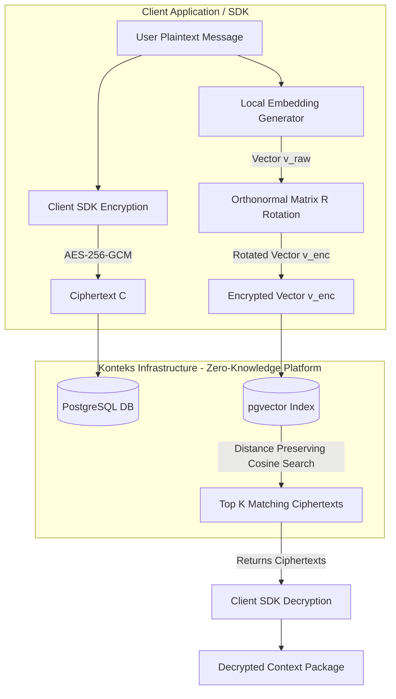

# Architecture Specification: Zero-Trust End-to-End Encrypted (E2EE) Context Engine

This document details the architectural design for integrating **End-to-End Encryption (E2EE)** and **Encrypted Vector Search** into Konteks (Context-as-a-Service). Under this model, Konteks operates as a **Zero-Knowledge Platform Provider**: storing message payloads, state variables, and semantic vectors without possessing the decryption keys or the ability to inspect user data.

---

## 1. Threat Model & Guarantees

> [!IMPORTANT]
> **Zero-Knowledge Principle**: Konteks stores encrypted blobs and transformed vector embeddings. Platform engineers, database administrators, and host OS processes cannot read plaintext messages, state variables, or invert vector embeddings back to text.



### System Security Guarantees

| Data Type | In-Transit Protection | At-Rest Storage Protection | Platform Visibility |
| :--- | :--- | :--- | :--- |
| **Message Content** | TLS 1.3 | AES-256-GCM Envelope Encryption | **Zero (Ciphertext Only)** |
| **State Variables** | TLS 1.3 | Client Key AES-256-GCM | **Zero (Ciphertext Only)** |
| **Vector Embeddings** | TLS 1.3 | Secret Orthonormal Transformation ($\mathbf{R} \cdot \mathbf{v}$) | **Distance-Preserving Only (No Inversion)** |
| **Metadata** | TLS 1.3 | Project ID, Room ID, Sequence, Token Counts | **Operational Metadata Only** |

---

## 2. Envelope Encryption Strategy for Messages & State

Each tenant/client maintains a Master Key ($\mathbf{K}_{master}$). Keys are never transmitted to Konteks.

### 2.1 Key Derivation Hierarchy
For each conversation room, a unique **Room Key** ($\mathbf{K}_{room}$) is deterministically derived using HMAC-HKDF:

$$\mathbf{K}_{room} = \text{HKDF-Expand}(\mathbf{K}_{master}, \text{"konteks-room-" } \parallel \text{room\_id})$$

### 2.2 Payload Encryption Payload Format
Before posting messages or state updates to Konteks API endpoints, the SDK constructs an encrypted container:

```json
{
  "version": "v1",
  "alg": "AES-256-GCM",
  "nonce": "d3f8a92b104c81a2e7b901f4",
  "ciphertext": "eyJhbGciOiJBRVMyNTYiLCJjdHgiOiJ..."
}
```

- **Konteks Database View**: Konteks stores this string in the `content` column of the `messages` table and the `state` column of the `room_state` table.
- **Decryption**: When fetching room history or state, the SDK receives the container and decrypts `ciphertext` using $\mathbf{K}_{room}$.

---

## 3. Encrypted Vector Search (Distance-Preserving Embedding Rotation)

Standard vector search over unencrypted embeddings exposes high-dimensional coordinates that could be susceptible to *embedding inversion attacks* (e.g., Vec2Text). To prevent this while retaining `pgvector` indexing capabilities, Konteks uses **Distance-Preserving Secret Transformation**.

### 3.1 Mathematical Foundation

Let $\mathbf{u}, \mathbf{v} \in \mathbb{R}^d$ be raw embedding vectors. The Cosine Similarity is:

$$\text{Sim}(\mathbf{u}, \mathbf{v}) = \frac{\mathbf{u} \cdot \mathbf{v}}{\|\mathbf{u}\| \|\mathbf{v}\|}$$

The Client SDK maintains a secret random **Orthonormal Rotation Matrix** $\mathbf{R} \in \mathbb{R}^{d \times d}$ generated via QR decomposition of a random Gaussian matrix:

$$\mathbf{R}^T \mathbf{R} = \mathbf{I}$$

Applying matrix multiplication to transform vectors:

$$\mathbf{u}_{enc} = \mathbf{R} \cdot \mathbf{u}, \quad \mathbf{v}_{enc} = \mathbf{R} \cdot \mathbf{v}$$

The inner product of transformed vectors strictly preserves original cosine similarity:

$$\mathbf{u}_{enc} \cdot \mathbf{v}_{enc} = (\mathbf{R}\mathbf{u})^T (\mathbf{R}\mathbf{v}) = \mathbf{u}^T (\mathbf{R}^T \mathbf{R}) \mathbf{v} = \mathbf{u}^T \mathbf{I} \mathbf{v} = \mathbf{u} \cdot \mathbf{v}$$

> [!TIP]
> **Zero Precision Loss**: Because orthonormal matrix multiplication preserves vector angles and Euclidean norms identically, `pgvector` HNSW/IVFFlat cosine search yields 100% exact mathematical relevance scores without Konteks ever learning the true embedding coordinates or text!

### 3.2 Workflow for Encrypted Semantic Memory

```
1. Client generates embedding v_raw = EmbeddingModel(message_text)
2. Client computes v_enc = R * v_raw
3. Client posts v_enc + AES_GCM_Encrypt(K_room, message_text) to Konteks API
4. Konteks indexes v_enc in pgvector table (memories)
5. Querying: Client computes q_enc = R * EmbeddingModel(query_text)
6. Konteks runs SQL: SELECT * FROM memories ORDER BY embedding <=> q_enc LIMIT 5
7. Konteks returns encrypted memory ciphertexts to Client
```

---

## 4. LLM Reasoning & State Extraction Models

State & Summary extraction requires an LLM to read conversation history and output structured variables. Under E2EE, two architectural models are supported:

### Option A: Client-Side SDK / Sidecar Proxy (Zero-Knowledge Core)
- State extraction runs on the client application or inside the client's cloud VPC (e.g. sidecar agent).
- The client decrypts message history, invokes the LLM directly, updates local state, encrypts state variables with $\mathbf{K}_{room}$, and syncs the encrypted state back to Konteks.
- **Pros**: Pure Zero-Trust architecture. Konteks servers handle zero plaintext.

### Option B: Hardware Enclave Execution (AWS Nitro Enclaves / TTEE)
- For centralized backend processing, Konteks processes state extraction within **Confidential Computing Enclaves** (AWS Nitro Enclaves / AMD SEV-SNP).
- $\mathbf{K}_{master}$ is provisioned to the enclave via KMS Attestation.
- Plaintext data exists **exclusively inside CPU hardware cache memory**, inaccessible to Konteks platform hosts, DB admins, or root OS processes.

---

## 5. Schema Delta Comparison

```diff
  CREATE TABLE messages (
      id UUID PRIMARY KEY,
      room_id UUID REFERENCES rooms(id),
      role VARCHAR(20) NOT NULL,
-     content TEXT NOT NULL, -- Plaintext
+     content TEXT NOT NULL, -- AES-256-GCM Base64 Container
      sequence BIGINT NOT NULL,
      created_at TIMESTAMP WITH TIME ZONE DEFAULT CURRENT_TIMESTAMP
  );

  CREATE TABLE memories (
      id UUID PRIMARY KEY,
      room_id UUID REFERENCES rooms(id),
-     embedding vector(1536), -- Raw embedding
+     embedding vector(1536), -- Orthonormal Transformed Vector (R * v)
-     content TEXT NOT NULL -- Plaintext memory
+     content TEXT NOT NULL  -- AES-256-GCM Base64 Container
  );
```
